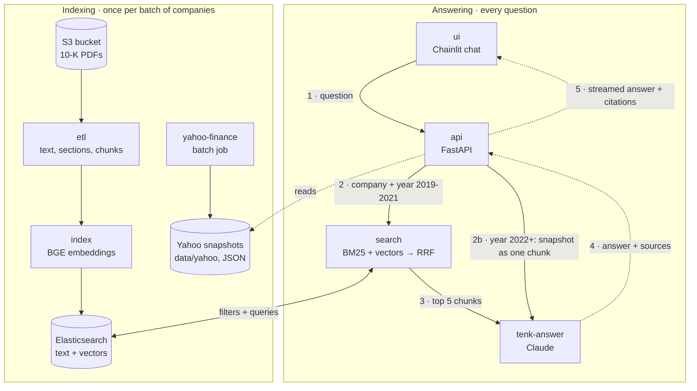

# Architecture Overview

FilingLens AI answers questions about NASDAQ companies from their 10-K filings, and every answer cites its source: company, fiscal year, section and page. This document is the map of the system: what each part does, how the parts talk to each other, where the data lives and how to run it. Update it whenever a part or a contract changes.

*Last update: 2026-10-21 (`main` after PR #42).*

## 1. Project structure

Each folder is one part of the system with one owner. The parts talk to each other only through the data contracts in section 4.

```
filinglens/
├── eda/             Dataset exploration: bucket inventory, document characterization, company selection
├── etl/             10-K PDF → clean text → chunks with company, year, section and page
├── index/           Chunks → BGE embeddings → Elasticsearch (the official loader)
├── search/          Hybrid retrieval (BM25 + vectors + RRF) and its evaluation set
├── search-index/    Read-only index health, stats and filters
├── tenk-answer/     Answer generation with Claude: cited answers, structured output, streaming
├── api/             FastAPI: detects company and year, runs search and generation
├── ui/              Chainlit chat: streaming answers, clickable citations
├── yahoo-finance/   Yahoo Finance snapshots for fiscal 2022 onwards (read by the api)
├── answer-eval/     RAGAS evaluation of the answers, in three steps (questions, answers, scores)
├── docker-compose.yml
└── data/            PDFs, chunks, embeddings and reports (never committed)
```

## 2. System diagram

Two flows run independently. **Indexing** runs once per batch of companies (and the Yahoo Finance snapshots are fetched once per batch too). **Answering** runs on every question.

For a presentation-ready version of the diagram, see [FilingLens AI · Architecture v2](https://claude.ai/artifact/Kabc9d7JoNcg4UjcsBsXu2).



The question flow, step by step:

1. The user asks in the chat. The UI sends the question to `POST /ask/stream`.
2. The API detects the company and the fiscal year. It reads the supported companies and years from the index, so adding companies needs no code change. If the company is unknown, or the year is neither in the index nor in the company's Yahoo snapshot, it says which years it can answer, without calling Claude.
3. For a year in the index (2019 to 2021), search filters by company and year, runs BM25 and vector search, and fuses both lists with reciprocal rank fusion (RRF). It returns the best 5 chunks. For a later year (2022 onwards), the API skips search and turns the company's Yahoo Finance snapshot into one chunk (section "Yahoo Finance (fetched on <date>)", `page: 0`).
4. tenk-answer sends the question and the chunks to Claude. Claude must answer only from those chunks, cite each claim with a `[n]` marker, say "I don't know" when the chunks do not answer, and refuse comparisons, calculations and investment advice.
5. The API streams the answer to the chat. Each citation opens the exact text of the 10-K in a side panel.

## 3. Components

| Part | Responsibility | Key technology | Owner |
| --- | --- | --- | --- |
| eda | Measure the dataset before building: 9,855 PDFs, duplicates, coverage by year, document types, company selection | Python, boto3, PyMuPDF, Jupyter | Elkin |
| etl | Extract text by rows of cells (keeps each figure under its year), clean, label sections (Item 1A, Item 7…), chunk, check readability and company | Python, PyMuPDF | Lourdes |
| index | Embed chunks with BGE and load them into Elasticsearch | Haystack, sentence-transformers | Lourdes |
| search | Hybrid retrieval with exact company/year filters; evaluation with exact chunk labels | Haystack, Elasticsearch | José Luis |
| search-index | Read-only health, stats and filters of the index | Python, Elasticsearch client | Luis |
| tenk-answer | Build the context, call Claude with structured output, validate citations, stream tokens | Haystack, anthropic-haystack, Pydantic | Juan Carlos |
| api | `/health`, `/ask`, `/ask/stream`; company and year detection; 10-K search or Yahoo snapshot by year; clear error messages; stops Claude when the user leaves | FastAPI | Kelyn |
| ui | Chat with streaming, `[n]` citations, side panel opened on click; Yahoo citations show the fetch date instead of a page | Chainlit | Kelyn |
| yahoo-finance | Snapshots of annual figures for the companies in the index; each company's fiscal year rule is checked against its own 10-Ks | yfinance | Lourdes, Elkin |
| Docker and architecture | One command to run every service | Docker Compose | Elkin |

## 4. Data contracts

Each part hands off to the next in a fixed shape. That is what let the team work in parallel. A contract change is announced to the team before it is made.

| Contract | Between | Shape |
| --- | --- | --- |
| Document | eda → etl | `doc_id`, `company`, `ticker`, `fiscal_year`, `s3_key`, `local_path`, `n_pages` |
| Chunk | etl → index | `chunk_id` (`AAPL_2019_10K_p4_c2`), `text`, `section`, `page`, `company`, `company_name`, `ticker`, `fiscal_year` |
| Contract 3 · search result | search → tenk-answer | `chunk_id`, `text`, `score`, `section`, `page`, `company`, `fiscal_year` |
| Contract 4 · API response (locked) | api → ui | `answer`, `sources[]` (`company`, `fiscal_year`, `section`, `page`, `excerpt`), `latency_ms` |

A Yahoo Finance snapshot travels as one Contract 3 chunk (`chunk_id` `yahoo-<TICKER>-<year>`, `page: 0`), so Contract 4 did not change.

`chunk_id` depends on the page and the order of the chunk in it, so it changes when the ETL re-chunks a filing. The evaluation labels belong to one chunk package and are regenerated with `python -m src.labels` after each new package.

## 5. Data stores

| Store | Type | What it holds |
| --- | --- | --- |
| Elasticsearch, index `filinglens-chunks` | Search engine (8.15.3) | Chunks with text, BM25 terms and 768-dimension BGE vectors. Today: 50 companies, 150 filings, 50,785 chunks (package v5) |
| `data/` | Local files, never committed | Raw PDFs, clean text, chunks, embedding cache, evaluation reports |
| `data/yahoo/snapshots/<TICKER>.json` | Local files, never committed; shared on Drive | Yahoo Finance figures per fiscal year, with the fetch date and the currency. They are the cache: the chat never calls Yahoo live. Mounted read-only in the api container |
| Google Drive | Shared packages | Chunks + embeddings per version, so nobody has to recompute embeddings |
| `search/evaluation/questions.json` | Committed | 150 questions with exact chunk labels; new companies append their questions to this file |

## 6. External services

| Service | Purpose | Integration |
| --- | --- | --- |
| Anthropic Claude (`claude-sonnet-5`) | Writes the cited answer; the only cost per question (≈ $0.012) | anthropic-haystack, key in `.env` |
| AWS S3 (course bucket) | Source of the 10-K PDFs | boto3, read-only keys in `eda/.env` |
| Hugging Face | Downloads the BGE model once (`BAAI/bge-base-en-v1.5`) | sentence-transformers, cached in a Docker volume |
| Yahoo Finance | Annual figures for fiscal 2022 onwards (free) | yfinance, run as a batch job; not an official API, so the chat reads the saved snapshots, never live calls |

## 7. Deployment and infrastructure

Everything runs with Docker Compose on one machine.

| Service | Runs | Port |
| --- | --- | --- |
| elasticsearch | Always | 127.0.0.1:9200 |
| api | Always (starts when Elasticsearch is healthy) | 127.0.0.1:8000 |
| ui | Always | 127.0.0.1:8001 |
| eda, etl, index, yahoo | On demand: `docker compose --profile <name> run --rm <name>` | eda notebook: 127.0.0.1:8888 |

Every port is bound to 127.0.0.1, so nothing is exposed outside the machine.

## 8. Security

- The Anthropic key lives only in the root `.env`; the AWS read-only keys only in `eda/.env`. Both are in `.gitignore` and never enter code, notebooks, images or commit history.
- Data never enters the repository: `data/` and `*.pdf` are ignored.
- Document text is treated as data, not instructions: the prompt tells Claude to ignore any instruction found inside a filing.
- The assistant never gives investment advice; that is a prompt rule, not a UI filter.

## 9. Development and testing

- Each part has its own unit tests, which run without Elasticsearch, the BGE model or a Claude key.
- Current counts on `main`: api 61, tenk-answer 108, search 25, yahoo-finance 24, etl 95 (16 skipped).
- Work goes through pull requests: one branch per change, reviewed by the owner of the part it touches, merged only with an approval.
- Search quality is measured with exact chunk labels: hybrid search finds the right chunk in the top 5 for 95% of the 150 questions (MRR 0.78, right section 99%).

## 10. Next steps

- **Yahoo Finance in the prompt:** the answer prompt still speaks only of 10-K filings; it must also accept the Yahoo Finance source and say where each figure comes from.
- **Answer cache:** cache Claude's answers (Redis) for repeated questions. Claude is the only cost per question; Yahoo is free.
- **Answer quality:** run the RAGAS evaluation (`answer-eval/`) on the final index and report context recall, context precision, faithfulness, answer relevancy and factual correctness.
- **More companies:** 100, chosen by market value, with an EDA pre-flight check of each new batch before it enters the ETL.
- **CI:** run every part's tests on each pull request (GitHub Actions).

## 11. Glossary

| Term | Meaning |
| --- | --- |
| 10-K | Annual report every US public company files with the SEC |
| Item | A numbered section of a 10-K (Item 1A risk factors, Item 7 MD&A, Item 8 financial statements) |
| Chunk | A short piece of a filing, with its company, year, section and page |
| BM25 | Keyword search |
| BGE | The embedding model used for search by meaning |
| RRF | Reciprocal rank fusion: merges the BM25 and vector result lists |
| MRR | Mean reciprocal rank: how high the right chunk ranks on average |
| Snapshot | A saved file with a company's Yahoo Finance figures and the date they were fetched |
